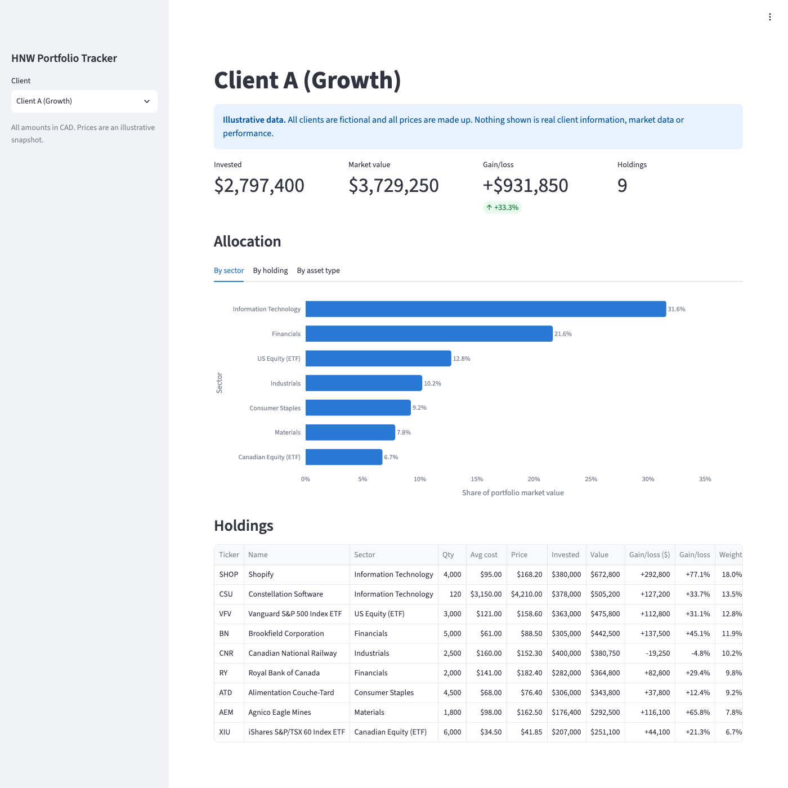

# HNW Portfolio Tracker

[](https://github.com/Max123-cloud37672/Personal-Portfolio-/actions/workflows/ci.yml)

A portfolio tracker for high-net-worth (HNW) clients, built in Python with a
Streamlit dashboard. An advisor picks a client and sees what they hold, what it
is worth, how much it has gained or lost, and how the portfolio is allocated.

> **Illustrative data only.** All clients are fictional and all prices are made up.
> The tickers are real Canadian listings, used only so the example looks familiar.
> Nothing in this project is real client information, real market data, real
> investment performance or a recommendation.



## Features

- **Client selector** for three fictional clients: Growth, Income and Balanced
  mandates, each with $2M to $6M invested in Canadian-listed stocks and ETFs.
- **Headline numbers:** amount invested, market value, gain/loss in $ and %, and
  number of holdings.
- **Allocation charts** by sector, by holding and by asset type (stock vs ETF).
- **Holdings table** with quantity, average cost, price, invested, value,
  gain/loss and portfolio weight, sortable by any column.
- **Validated data loading:** bad rows in the CSV files are reported with the
  file name and line number instead of producing wrong numbers.

## Running it

Requires Python 3.14.

```bash
python3.14 -m venv .venv
source .venv/bin/activate
pip install -r requirements.txt
streamlit run app/dashboard.py
```

The dashboard opens at <http://localhost:8501>. Stop it with Ctrl + C.

## Key calculations

**For one holding**, e.g. 500 shares bought at an average of $120, now $135:

| Measure | Formula | Example |
|---|---|---|
| Cost basis (amount invested) | quantity × average cost | 500 × $120 = $60,000 |
| Market value | quantity × current price | 500 × $135 = $67,500 |
| Gain/loss ($) | market value − cost basis | +$7,500 |
| Gain/loss (%) | gain/loss ÷ cost basis | +12.5% |

**For a portfolio:**

| Measure | Formula |
|---|---|
| Totals | the sum of each holding's cost basis, market value and gain/loss |
| Total gain/loss (%) | total gain/loss ÷ total cost basis (not an average of the holdings' percentages) |
| Weight of a holding | holding market value ÷ portfolio market value (all weights add up to 100%) |
| Sector or asset-type allocation | the sum of the weights of the holdings in each group |

In plain terms: *"Weights are based on today's market value, not on what was paid,
because allocation describes what the client owns now."*

## Data

The sample data lives in two CSV files in [`data/`](data/):

| File | One row per | Columns |
|---|---|---|
| `prices.csv` | security | ticker, name, asset_type (`Stock` or `ETF`), sector, current_price |
| `holdings.csv` | client position | client, ticker, quantity, average_cost |

Keeping prices separate from positions means every security has **one** price,
shared by every client who holds it, much like a security master and a
positions file in a real system.

## Assumptions

- Canadian-listed stocks and ETFs only; all amounts in CAD.
- Prices are a single illustrative snapshot, not live market data.
- Gain/loss is unrealized: sales, dividends, fees and taxes are not modelled.
- ETFs are classified by a label such as "Fixed Income (ETF)" rather than by
  looking through to the securities they hold.

## Design

- **`Holding`** and **`Portfolio`** are immutable dataclasses that check their
  inputs when created, so an invalid holding (e.g. a negative quantity) can never
  exist. Because cost basis is always positive, the percentage calculations can
  never divide by zero.
- **No finance logic in the dashboard.** `app/dashboard.py` only formats and
  displays what `portfolio_tracker` calculates, so every number is testable
  without a browser.
- **Errors say where the problem is**, e.g.
  `holdings.csv line 7: quantity must be a number, got 'abc'`.

## Testing

```bash
pytest
ruff check .
```

59 tests, written before the code they test:

| Test file | Tests | Covers |
|---|---|---|
| `test_holding.py` | 21 | calculations, losing positions, immutability, every validation rule |
| `test_portfolio.py` | 16 | totals, weights, sector and asset-type allocation, table, validation |
| `test_data_loader.py` | 14 | loading, shared prices, missing columns, bad and empty cells, unknown tickers |
| `test_dashboard.py` | 7 | the page runs, the notice is shown, numbers are formatted, switching clients |
| `test_setup.py` | 1 | the package can be imported |

GitHub Actions runs Ruff and the full test suite on a clean machine for every
pull request. See [`.github/workflows/ci.yml`](.github/workflows/ci.yml).

## Project structure

```
app/dashboard.py          Streamlit page (display only)
src/portfolio_tracker/
    holding.py            Holding: one position and its gain/loss
    portfolio.py          Portfolio: totals, weights, allocation, table
    data_loader.py        reads and validates the two CSV files
    validation.py         shared input checks
data/                     illustrative prices and client holdings
tests/                    pytest test suite
.github/workflows/ci.yml  continuous integration
DEVLOG.md                 what I learned, bugs and decisions
```

## Limitations and possible next steps

- **US-listed holdings** would need a currency field and a USD→CAD conversion.
- **Live prices** from a market-data source instead of a CSV snapshot.
- **Performance over time** (time-weighted returns) would need transaction history.
- **Income view:** dividend yield and expected annual income per client.
- Entering or editing holdings from the dashboard instead of the CSV files.

## How this was built

This is a learning project, built in October 2026 with Claude (Anthropic's AI
assistant) as a coding tutor. Claude wrote most of the code and tests and
explained each part as it went. I chose the project's direction and scope,
approved each design, ran the tests, and made every commit and pull request
myself. The parts I wrote myself are the `number_of_holdings` property and its
test, the Client C sample data, and the dashboard's Holdings figure. The
[DEVLOG](DEVLOG.md) records what I learned, the bugs I hit and the decisions
along the way.
